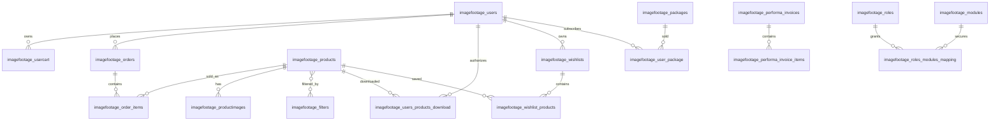

# Database relationships

The following relationship map is limited to relationships observable in model methods and migration foreign-key/index declarations. It is not a live ERD.

The database entity CSV names the migration files, model mappings, and relationship evidence. Foreign-key completeness is unknown because migrations use both explicit constraints and application-level identifiers, and the live schema was not inspected.
