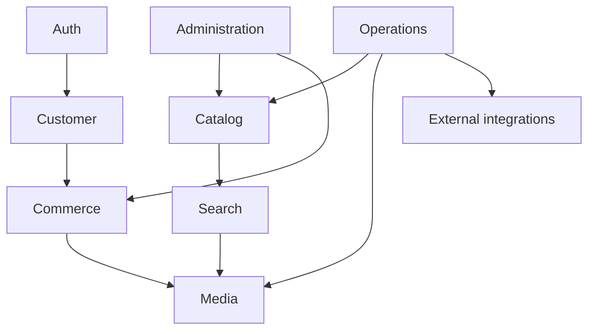

# Module architecture

| Module | Primary implementation | Main dependencies |
|---|---|---|
| Authentication | `AuthController`, `Auth\*Controller`, `JwtMiddleware`, `User` | JWT, session guards, Google/Facebook, mail/SMS |
| Catalog | `ProductController`, `ProductApiController`, `Product`, product attribute models | MySQL, Panther/Pond5 data |
| Search | `SearchController`, `ElasticSearchController`, `FiltersController`, `TrendingWord` | MySQL, Elasticsearch, provider APIs |
| Customer | `UserController`, `FrontuserController`, contact/password controllers | User/profile/cart/package models |
| Commerce | `PaymentController`, `InvoiceController`, order/package/promo controllers | Razorpay, PayU, Atom, Dompdf, mail |
| Media | `MediaController`, `ProductImages`, download models | Storage, remote URLs, image/video libraries |
| Wishlist/editorial | `WishListController`, `EditorialController`, wishlist/editorial models | MySQL, API clients |
| Administration | `app/Http/Controllers/Admin/*`, `Admin` and `CheckPermission` middleware | session auth, permission tables, Blade |
| Operations | `CronController`, `app/Jobs`, console commands | queue, scheduler, third-party providers |

Communication is primarily direct controller-to-model/helper calls. Dependency injection is used for selected services, notably `SmsService` and the Elasticsearch client. Event/listener usage is limited to Laravel email verification registration in `EventServiceProvider`; the codebase does not show a broad domain-event architecture.

