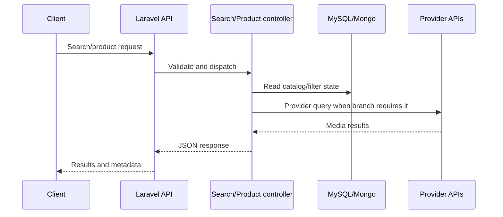

# Business logic and workflows

## Registration/login

`AuthController` handles API signup/login variants, OTP/verification, password reset, and JWT issuance. Web login uses Laravel session controllers. Social-login paths use Google/Facebook identifiers and the custom JWT middleware supports normal, Google, and Facebook request modes. Exact field rules are implemented in controllers and `SignUpRequest`, `SearchRequest`, and `ChangePasswordRequest`.

## Catalog and search

Search requests enter `SearchController` or `ElasticSearchController`, apply query/filter/category logic, and return product/media records. Product detail is handled by `ProductController`; filter metadata is served by `FiltersController`. Provider-backed search/import behavior is implemented through Panther/Pond5 wrappers and `FetchThirdPartyData`.

## Cart, checkout, and orders

Cart endpoints write/read `imagefootage_usercart` through `FrontuserController` and related models. Payment endpoints in `PaymentController` create or locate order/invoice records, redirect or initiate a gateway transaction, and process callback responses. Admin invoice controllers manage quotations, invoices, comments, purchase orders, subscription invoices, and status changes.

## Downloads

`MediaController` exposes sample, multiple, re-download, and licence flows. Download authorization is represented by `imagefootage_users_products_download` models/tables and user/package/order state; file delivery can be local or provider URL based depending on the product record and controller branch.

## Background/provider workflow

`FetchThirdPartyData` queries Panther/Pond5 wrappers and persists media through product model methods. Console commands update currency, expire quotations, carry forward package balances, and regenerate Panther URLs. The scheduler activates quotation expiry hourly and carry-forward balance daily.

Financial and authorization rules are recorded as implemented; this document does not reinterpret them or propose changes.
