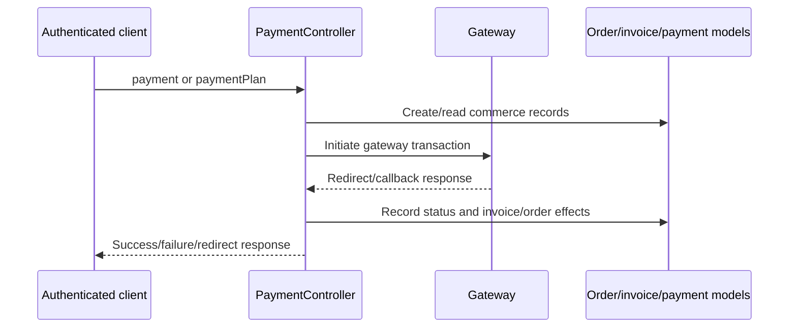

# Payment system

## Gateways and evidence

The repository integrates Razorpay (`razorpay/razorpay`), PayU Money (`riazxrazor/payumoney`), and a custom AtomPay implementation (`app/Http/AtomPay`). Configuration is in `config/payments.php`, `config/payumoney.php`, and `config/services.php`; credentials are environment-backed and are not reproduced here.

`PaymentController` contains initiation and callback methods including `payment`, `paymentPlan`, `payU`, `payUplan`, `payUResponse`, `payUplanResponse`, `razor_response`, `razor_plan_response`, Atom response methods, invoice callbacks, and success/failure views. Route registrations are in `routes/api.php` and `routes/web.php`.

## Observable lifecycle

## Integrity observations

Verified: multiple callback routes exist, payment status fields are persisted in order/invoice/package models, and callbacks are not all JWT-protected because providers call them. Unknown: gateway dashboard webhook signing, idempotency guarantees under duplicate callbacks, distributed locking, reconciliation jobs, retry policy, and live refund behavior. The repository contains no clearly named payment-reconciliation job or general gateway retry abstraction; individual controller branches must be reviewed for provider-specific behavior.
