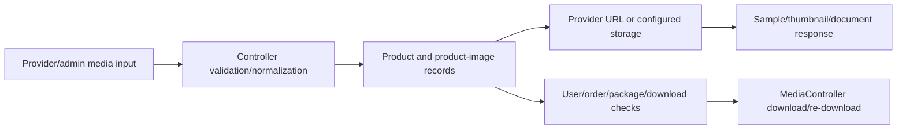

# Media and file management

Media enters through provider search/import flows, product/admin upload flows, and product image records. `ProductImages`, `Product`, `MediaController`, Panther/Pond5 wrappers, Intervention Image, Laravel FFmpeg, AWS SDK, and Dompdf-related code comprise the visible media/document surface.

The Dockerfile installs FFmpeg and GD-related libraries, which supports the declared media stack. Exact production disk, bucket, naming, cleanup, watermark, and signed-URL behavior is environment/branch dependent; the repository does not establish a complete end-to-end file lifecycle for every media type. The `storage`, `public`, `output`, `tmp`, and `backend/storage` directories contain local/runtime artifacts and were not treated as a production contract.
