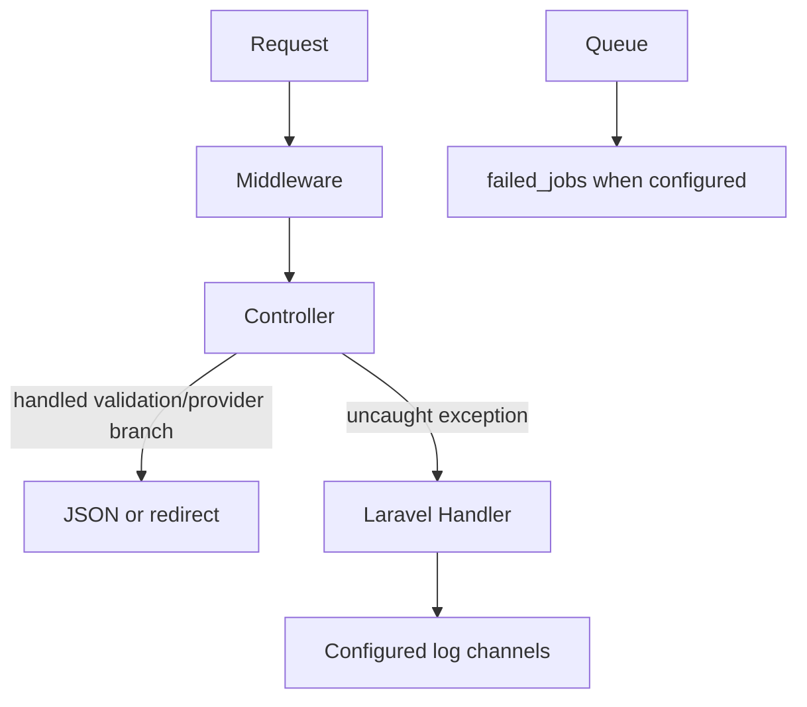

# Error handling and observability

`App\Exceptions\Handler` delegates reporting/rendering to Laravel’s base handler and excludes password fields from validation flashing. Controllers frequently return JSON status/error payloads or redirects with session errors. `config/logging.php` defines Laravel log channels and a Panther Media-specific log path. A Laravel log viewer provider is registered.

Queue failures are supported by the `failed_jobs` migration and Laravel queue configuration. No separate tracing, metrics, APM, structured audit-log, or repository-defined health-check implementation was verified. `APP_DEBUG` controls framework debug behavior; production values are not available.

