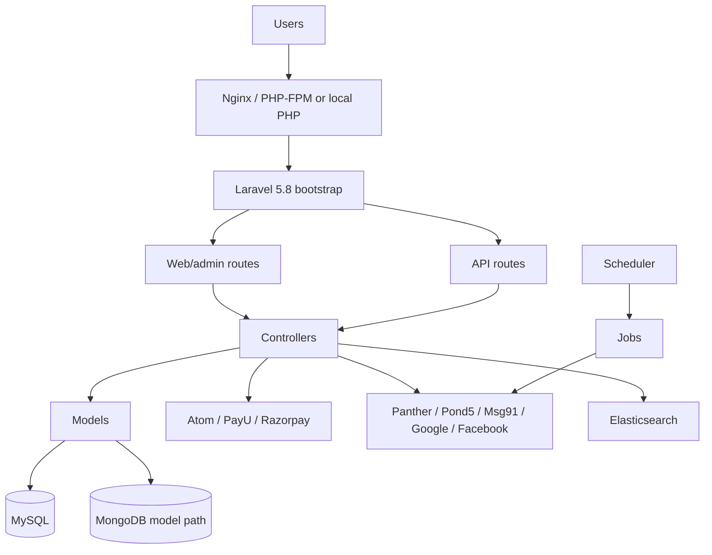
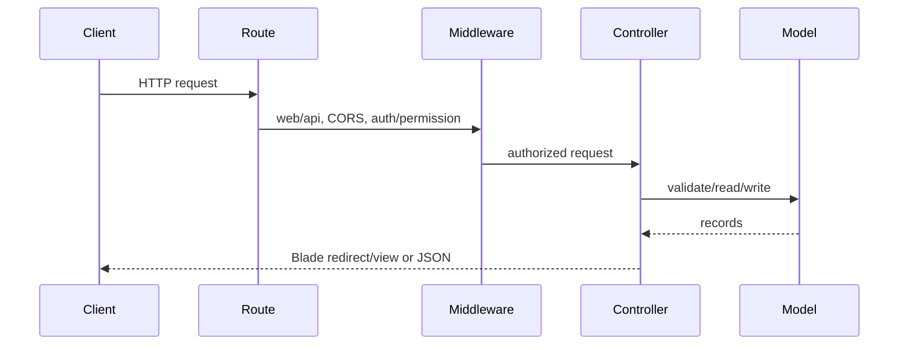
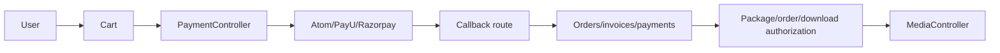
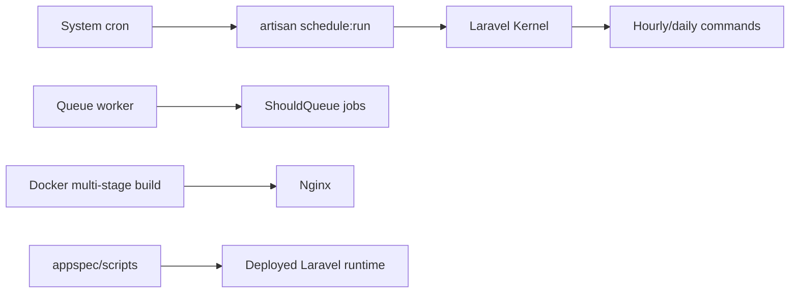

# Architecture diagrams

## Current application

## Request and identity lifecycle

## Commerce/payment/download

## Background/deployment

The diagrams contain only components verified in source/configuration; unverified production infrastructure is intentionally omitted.
