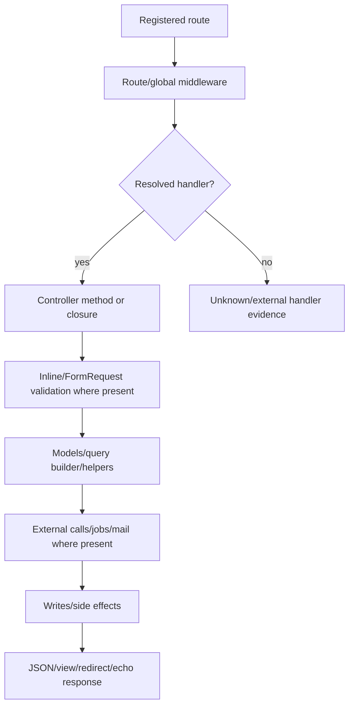

# Complete route execution analysis

## Method

The inventory was generated from `php artisan route:list --json`, then matched to controller files under `app/Http/Controllers`. For resolved methods, the analyzer recorded source line, request references, validation markers, response markers, model/table markers, external/job markers, and explicit transaction markers. This is a reproducible static trace; it is not a claim that every branch was exercised.

## Coverage

| Result | Count |
|---|---:|
| Registered route entries | 426 |
| API | 136 |
| Admin | 268 |
| Web/other | 22 |
| Controller method resolved | 408 |
| Unresolved external/missing method | 13 |
| Closure route | 5 |

The full route-by-route record is in `route-execution-inventory.csv`. Each row has route ID, method, URI, name, controller, middleware, auth/permission evidence, input/validation markers, response markers, model/database evidence, external/job markers, transaction markers, resolution status, and source evidence.

## Unresolved route handlers

The 13 unresolved rows are evidence gaps, not claims of broken behavior. They include the package log-viewer controller, resource routes whose controller method was not found by the static class map (`show`/`viewcontributor` variants), and web authentication controllers outside the `App\Http\Controllers` map. Five routes are closures in `routes/api.php` or `routes/web.php`; their bodies must be read directly rather than treated as controller calls.

## Request lifecycle

Route-level middleware is not equivalent to ownership authorization. For example, `jwt.verify`/`auth:api` proves a middleware requirement, while user ownership checks must be verified in each controller method.
