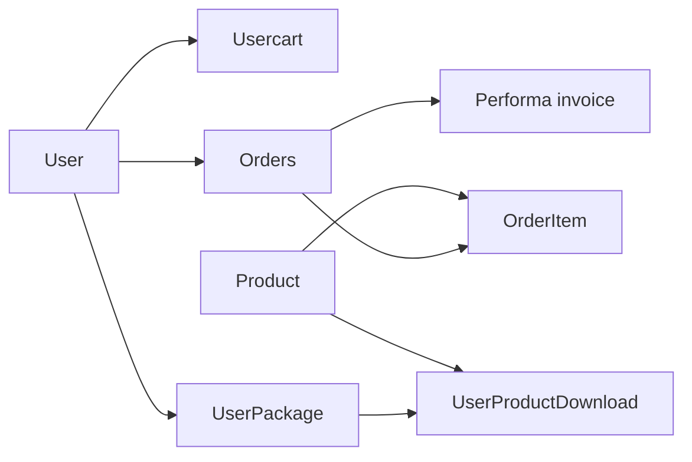

# Database operation map

## Scope

`database-read-write-matrix.csv` covers 113 distinct entities discovered from migration `Schema::create/table` calls. `model-usage-matrix.csv` covers all 65 model files and records table/connection mappings, method names, statically identified callers, and database helper markers.

## Verified write paths

- User registration writes `imagefootage_users` and then updates verification fields.
- Checkout writes `imagefootage_orders` and `imagefootage_order_items` before the gateway is completed.
- Payment callbacks update order payment/status fields, delete the user cart, and call invoice/email logic.
- Package purchase writes `imagefootage_user_package` and its callback branch updates package payment state.
- Downloads insert/update `imagefootage_users_products_download` and increment package counters.
- User deletion uses an explicit transaction and deletes related package, download, order, invoice, cart, subscription, payment, wishlist, and user records (`UserController.php:866-880`).

## Transaction evidence

The inspected source has explicit `DB::beginTransaction`, `commit`, and `rollBack` in user deletion. The inventory found no broad `DB::transaction` wrapper around payment initiation, payment callbacks, or multi-record download writes. This is a source observation, not a standalone vulnerability claim: provider callback behavior and database engine semantics still require runtime verification.

## Database diagrams

The live migration table and foreign-key state are unknown; model/table mappings are repository evidence only.
