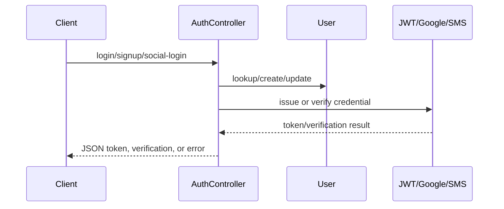

# Authentication execution flows

## Customer login

`POST /api/login` enters `AuthController::login`. Inline validation requires `email` and `password`; `auth()->attempt` issues a JWT on success, and `respondWithToken()` loads active `UserPackage` rows and profile-completion state. Invalid credentials return HTTP 401; validation failures return HTTP 200 with validator messages.

## Customer signup and verification

`signup` uses `SignUpRequest`; it saves an inactive user, creates an email verification token and expiry, and sends mail. `signupV2` accepts either email or a 10–15 digit phone-shaped value, saves inactive state, then sends email verification or an OTP through `SmsService`. Social Google signup auto-activates a newly created user and logs in; existing inactive users are rejected.

## JWT and social middleware

`config/auth.php` defines `api` as JWT with `User` provider. `JwtMiddleware` handles normal JWT parsing, Google fallback validation, and Facebook access-token validation based on `Login-Type`. It returns JSON 401 messages for invalid/expired/missing authorization. The controller constructor also applies `auth:api` except to public auth methods, creating two layers of route/controller auth behavior.

## Refresh/logout

`refresh` calls `auth()->refresh()` and returns a nested token payload; `logout` calls `auth()->logout()`. Route protection is explicit in `routes/api.php` and controller middleware.

## Admin authentication

`AdminController::authenticate/login/logout` is used by the `/admin` web routes. `Admin` checks `Auth::guard('admins')`; `CheckPermission` resolves the admin role/module/action and returns redirect or JSON 403. Super-admin role ID bypasses permission checks. Ownership checks for customer IDs are not uniformly centralized and must be reviewed per controller method.

