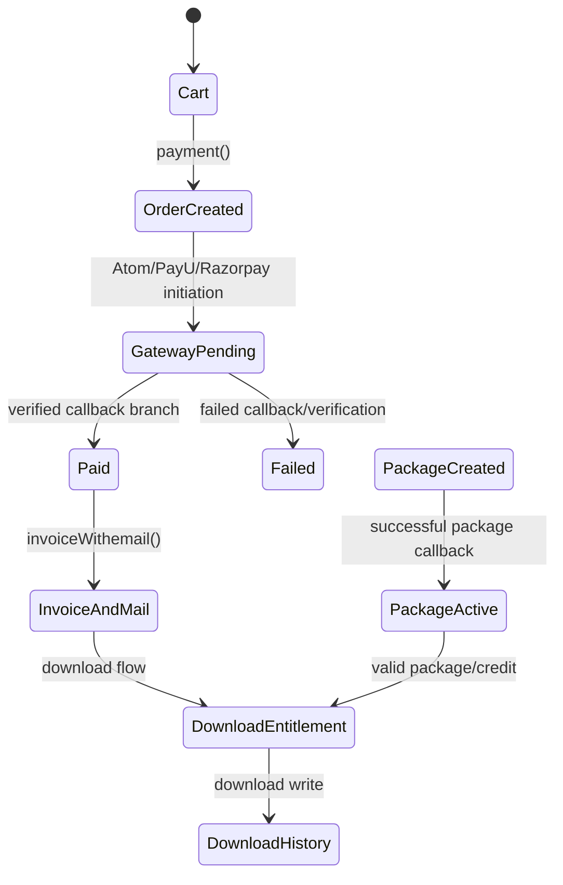

# Commerce execution flows

## Cart

The JWT route group exposes `add_to_cart`, `edit_to_cart`, `user_cart_list`, and `delete_cart_item`. `FrontuserController` reads/writes `Usercart`; `userCartList` enriches cart products and echoes JSON; `deleteCartItem` deletes by submitted cart ID. The source path should be read with ownership in mind because the delete method directly looks up the submitted ID.

## Individual checkout

`PaymentController::payment` consumes a nested request structure, loads the user and cart, subtracts an optional discount from the first cart value, applies `GST_VALUE` only when the user country code is `IN`, creates an `Orders` row and one `OrderItem` per cart item, then branches by `type`:

- `atom`: creates `TransactionRequest`, sets return URL `/api/atomPayResponse`, and returns a gateway URL.
- `payu`: returns `/payu/{transactionId}` for the browser flow.
- `rozerpay`: creates a Razorpay order, stores `rozor_pay_id`, and returns checkout data.

No package-credit deduction occurs in this individual `payment()` setup path. The source therefore documents regular cart/order creation independently of package download consumption; package credit is handled in download methods and package purchase state. This conclusion is limited to the inspected methods and does not imply every frontend checkout branch behaves identically.

## Packages/plans

`paymentPlan` rejects a new package when an active same-type package with remaining products exists. It creates a `UserPackage` record with plan details and gateway provider, then branches to gateway initiation. Package expiry, monthly windows, carry-forward, and credit balance are later handled by package/download logic and scheduled commands.

## State transition

No single transaction wraps all cart/order/gateway/invoice operations; failure analysis is in [12](12-failure-and-transaction-analysis.md).
