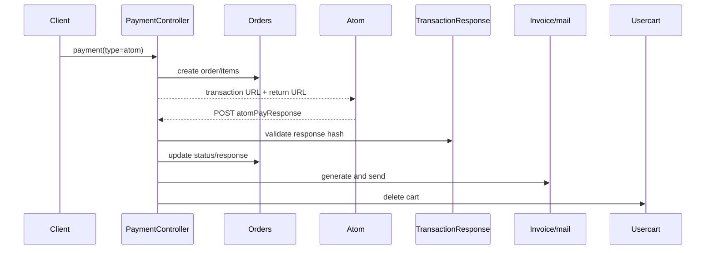
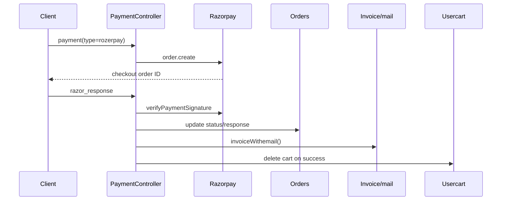

# Payment execution traces

## AtomPay

`payment()` creates order/items, builds `TransactionRequest`, and sets `/api/atomPayResponse`. `atomPayResponse` validates the response hash with `TransactionResponse`; on `f_code == Ok` it updates the order to `Transction Success`, stores response data, loads order/user/items, generates invoice/email, deletes the user cart, and redirects to confirmation. Invalid signature echoes `Invalid Signature`; non-OK status redirects to failure. Atom plan/invoice callbacks have separate methods and route entries.

## PayU Money

`payment()` creates order/items and returns `/payu/{transaction}`. `payu()` loads order/items/user and calls `Payumoney::pay` with success/failure URLs. `payUResponse()` calls `completePay`, requires checksum validity and success, updates order payment/status data, invoices/emails, deletes cart, and redirects. Failure redirects to order failure.

## Razorpay

`payment()` creates order/items, converts INR to paise, calls `$api->order->create`, stores `rozor_pay_id`, and returns checkout configuration. `razor_response()` calls `verifyPaymentSignature`; it loads the order, calls invoice/email logic before the success branch, then on success increments promo usage, updates order status/response, deletes cart, and echoes a redirect URL. Signature failure sets a local failure flag and returns a failure URL branch.

## Integrity gaps

Verified: Atom hash validation, PayU checksum check, and Razorpay signature verification are present. Verified source gap: no explicit idempotency key, callback lock, or duplicate-callback guard is visible in these controller branches; exact duplicate effects require runtime/database testing and are not declared safe or unsafe solely from absence.
