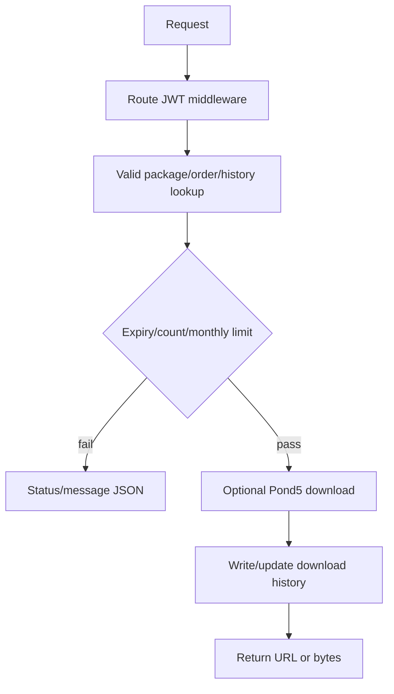

# Download authorization and delivery

## Package-based multiple download

`multipleDownload()` parses `userData` and `planId`, looks up an active completed package for the submitted user/package/type, checks expiry, subscription monthly window and `package_products_count`, then loads products and inserts `UserProductDownload` rows. It increments `UserPackage.downloaded_product` only when the pre-existing download check is false, and returns status strings such as `download_success`, `wrong_plan`, `download_limit`, or monthly-limit messages.

## Re-download

`reDownload()` looks up history by submitted `user_id`, `id_media`, and `type`. If missing, it returns a success-shaped message with null data. For type 2 it calls `Pond5ImageApi::download`, creates/updates a download history record with the returned URL or prior URL, and returns either a URL or `pending` response.

## Proxy and individual paths

`downloadProxy()` accepts a URL, rejects missing/non-http(s) values, fetches with cURL, disables SSL peer/host verification, and returns remote bytes with remote content type/filename. It does not establish ownership in this method. `downloadindi()` and `download()` contain separate product/package branches; their exact behavior is preserved in the route inventory and source evidence.

## Authorization observations

Download routes are in the `api,CORS,jwt.verify` group, but some methods consume user IDs from request fields or decoded token data rather than only the authenticated guard object. The repository shows package/order/history lookups; ownership and entitlement behavior is therefore method-specific. Local/cloud versus provider origin is also method-specific: history may store provider URL, and Pond5 can be called for a fresh URL.

