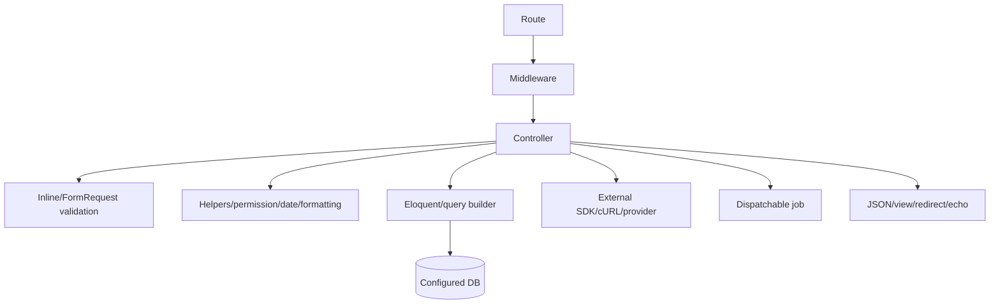
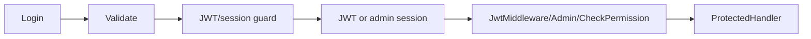
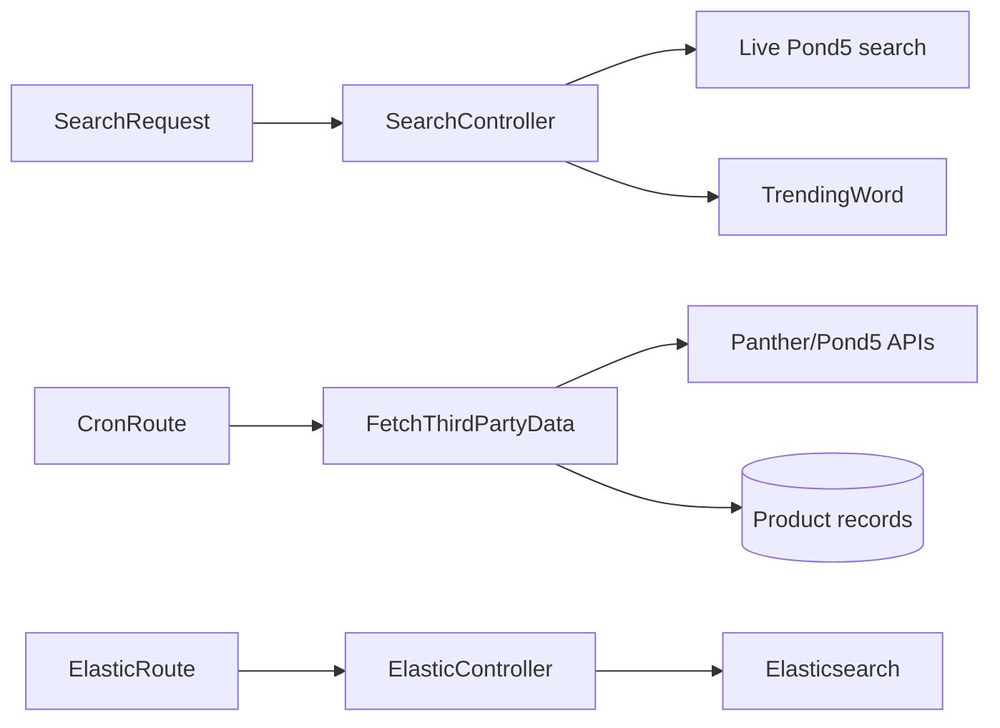
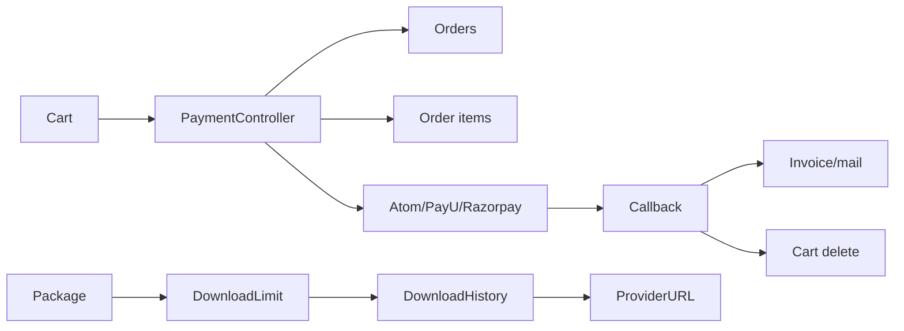
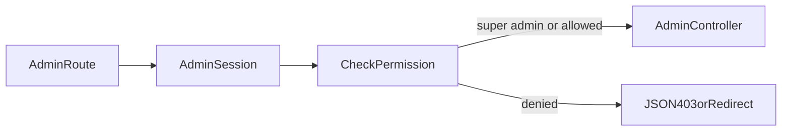

# Detailed execution diagrams

## Controller/model call path

## Authentication

## Search and ingestion

## Commerce/payment/download

## Admin authorization

Only repository-observed components are shown; production load balancers, workers, and provider dashboards are omitted.
