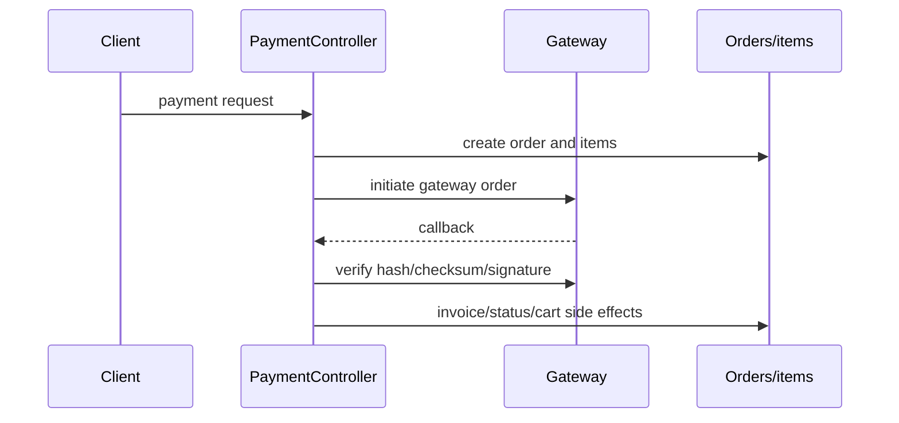

# Payment integrity verification

## Financial calculation

`PaymentController::payment` creates a transaction ID with `rand(1,1000000)` plus time, subtracts optional `discountValue` from `cartval[0]`, applies `GST_VALUE` (configured 18) only when the user country code is `IN`, rounds tax to two decimals, and stores `order_total = cartval[0] + final_tax` (`PaymentController.php:419-470`). INR Razorpay amounts are multiplied by 100; non-INR amounts are passed in currency units (`:539-551`).

The handler trusts request-supplied cart values, discount fields, billing fields, and nested product/cart data. A server-side recomputation from authoritative product prices is not visible in this method.

## AtomPay

Initiation creates order/items before building `TransactionRequest` and uses `/api/atomPayResponse`. The callback validates the response hash, checks `f_code == Ok`, updates order status/response, generates invoice/email, deletes cart, and redirects. The code matches the transaction through `mer_txn` but no amount comparison or duplicate-callback marker is visible.

## PayU Money

`payu()` loads the existing order and calls `Payumoney::pay` with amount, product IDs, customer fields, and success/failure URLs. `payUResponse()` requires `checksumIsValid()` and `isSuccess()`, updates order status/payment mode/response, generates invoice/email, deletes cart, and redirects. No visible amount comparison, callback idempotency key, or transaction lock is present.

## Razorpay

Initiation calls `order->create`, stores `rozor_pay_id`, and returns checkout data. `razor_response()` verifies the payment signature, loads the order by gateway order ID, then calls `invoiceWithemail()` before the success-status branch (`PaymentController.php:692-727`). On success it increments promo usage, updates order status/response, and deletes cart. No visible amount comparison, callback idempotency guard, row lock, or refund implementation was established.

## Duplicate/failure behavior

Repeated successful callbacks can reach invoice/email logic and cart deletion again because no explicit processed-callback guard is visible. This is a **verified missing-protection marker**, not a tested duplicate callback. Failed gateway initiation can occur after local order/items have been written; no compensating cleanup is visible. A later failed callback can redirect failure, but exact interaction with previously successful state requires runtime testing.

