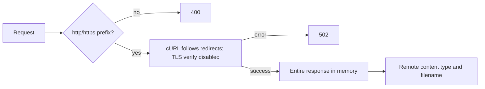

# Download and media security

## Entitlement checks

Download routes are generally in the `jwt.verify` group. `multipleDownload` checks completed/success package status, user/package/type, expiry, monthly or total download count, then writes download history and increments the package counter. `reDownload` checks a history record and may call Pond5 for a fresh URL. These checks are method-specific and use submitted identifiers in several paths.

## `downloadProxy()` review

`MediaController::downloadProxy` (`:690-730`) accepts a user-supplied `url`, checks only that it begins with `http://` or `https://`, calls cURL with `CURLOPT_FOLLOWLOCATION=true`, disables `CURLOPT_SSL_VERIFYPEER` and `CURLOPT_SSL_VERIFYHOST`, has no visible timeout or response-size limit, and returns the complete response body using the remote content type and basename.

Verified implications:

- Potential SSRF/destination-control risk: no IP, hostname, private-network, DNS-rebinding, or redirect-destination validation is visible.
- Insecure transport verification: TLS certificate and hostname verification are explicitly disabled.
- Resource exhaustion risk: no visible timeout, maximum body size, or streaming limit.
- Authorization gap: this method itself does not verify user entitlement before fetching the URL.
- Filename/content-type are derived from remote input; response header/content handling is not strongly constrained.

No request was made to an internal, metadata, production, or unauthorized destination. These are source-level findings, not exploit results.

