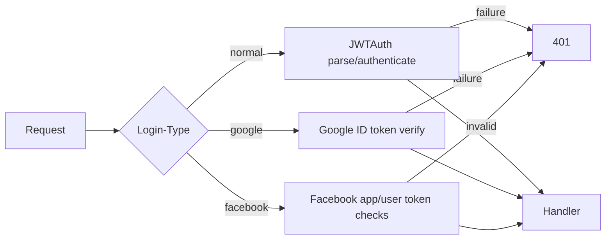
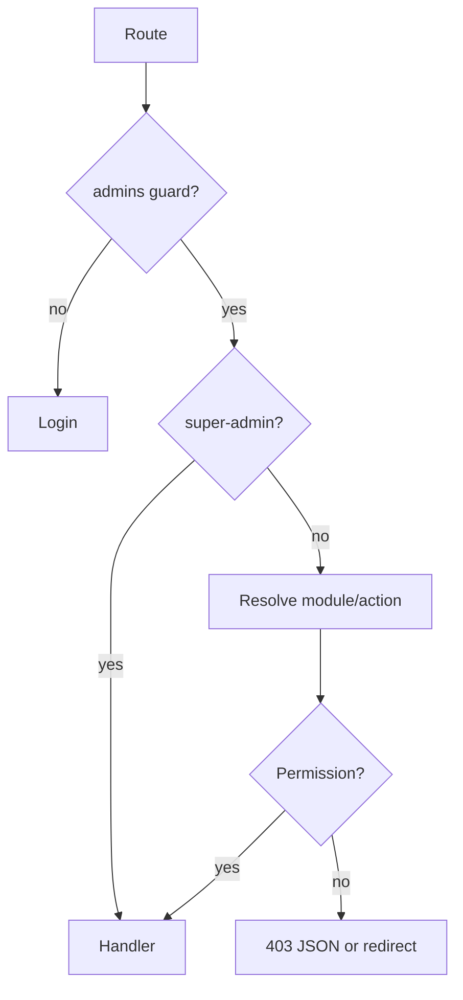
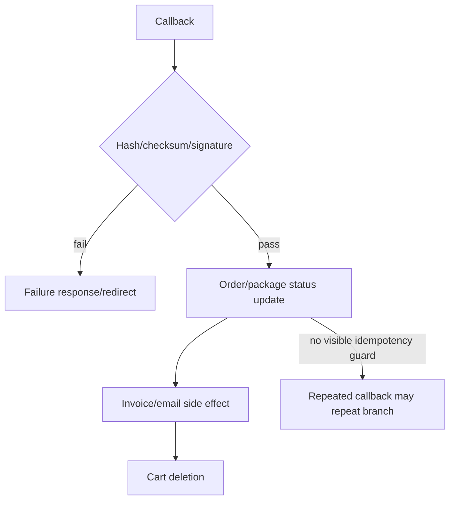
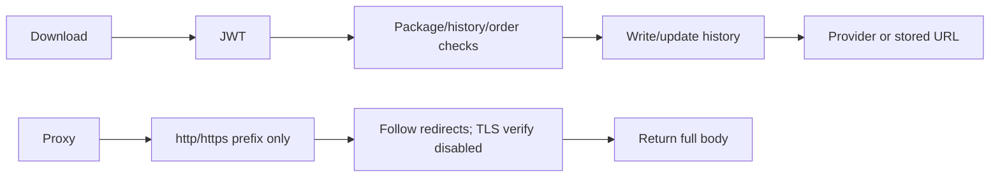
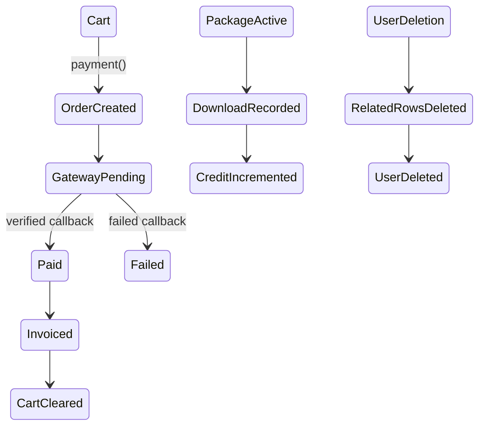

# Verification diagrams

## JWT/social validation

## Admin permission

## Payment callbacks

## Download/proxy

## Database state

Transitions involving live provider responses, database locks, duplicate callbacks, and deployed workers are marked by the surrounding documents as unknown or source-only.
