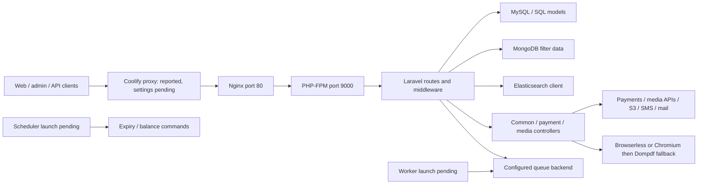

# Repository and architecture

## Repository map — VERIFIED

Tracked file inventory at audit start (before these documents): root 28; `.github` 2; `.vscode` 1; `app` 178; `backend` 1; `bootstrap` 2; `config` 26; `database` 201; `db files` 1; `docker` 2; `email_task` 12; `public` 10,035; `resources` 209; `routes` 5; `scripts` 3; `storage` 23; `tests` 4. Counts include tracked placeholder/data/legacy files, not just executable source. Local ignored `vendor`, `node_modules`, `tmp`, and `output` also exist. Existing database/data files were not opened or treated as verified backups.

| Area | Evidence and responsibility |
| --- | --- |
| `public/index.php`, `bootstrap/app.php` | HTTP front controller and application/container bootstrap |
| `artisan`, `app/Console/Kernel.php` | Console entry point and scheduled commands |
| `server.php`, `.htaccess` | Development-server/Apache routing support; not Coolify runtime proof |
| `routes/web.php` | Web/auth routes, admin prefix/controller namespace, quotations, invoices, optional PDF previews |
| `routes/api.php` | `/api` registration via RouteServiceProvider; public endpoints, JWT group, v2/v3, callbacks and cron-like endpoints |
| `routes/console.php`, `routes/channels.php` | Additional console definitions and broadcast authorization |
| `app/Http/Controllers` | 60 files including admin/customer/auth/payment/search/media and legacy-looking variants |
| `app/Models` | 65 files; SQL Eloquent models plus MongoDB model and substantial business orchestration in `Common.php` |
| `app/Http/Middleware`, `app/Http/Kernel.php` | Admin/session authentication, JWT, permissions, CORS, CSRF, trusted proxies and request normalization |
| `app/Providers` | Application bindings, auth, route registration, events, broadcast and Elasticsearch bindings |
| `app/Services/Sms` | SmsService, contract and Msg91 provider; additional `app/Http/TnnraoSms` integration |
| `app/Support/BrowserPdf.php` | Browserless/local Chromium rendering, temporary files, PDF output |
| `app/Jobs` | FetchThirdPartyData, SendEmail, SendPlanEmail |
| `app/Console/Commands` | Five command files; see runtime inventory |
| `app/Mail`, `app/Http/Mail`, `resources/views/email`, `email_task` | Mail builders, Blade templates and custom quotation HTML |
| `app/Http/Pond5`, `PantherMedia`, `AtomPay` | Third-party media and additional payment adapters |
| `database` | 165 migration files, seeders and factories; none executed |
| `resources/js`, `resources/sass`, `webpack.mix.js` | Mix 4/webpack asset pipeline; Vue 2 plus legacy AngularJS dependency |
| `public` | Distributed frontend/vendor assets and upload paths; many assets are tracked |
| `storage` | Runtime/framework state, logs and generated PDFs; deployed mounts PENDING |
| `Dockerfile`, `docker/nginx.conf` | Two-stage Node build then PHP-FPM/Nginx image |
| `Dockerfile.txt`, `docker/nginx.conf.txt` | Alternate copies; not assumed active |
| `appspec.yml`, `scripts/*`, `.github/workflows/*` | Historical/alternative deployment paths; applicability must be verified |

`common_old.php` and `PaymentController_live.php` are present. Their names suggest historical copies (**INFERRED**), but they must not be removed until references and Composer class loading are checked.

## Request and background architecture

Nginx/FPM routing and application integration code are **VERIFIED source facts**. Which database/queue/storage drivers production selects, external service versions, topology, and worker/scheduler launch mechanisms are **PENDING**. Coolify/Dockerfile usage is user-reported; its live configuration was not accessed.

`RouteServiceProvider.php` preserves `App\Http\Controllers` string-action resolution; web admin routes use namespace `Admin` and prefix `admin`. The admin protected group has `admin` and `check.permission`; the JWT API group uses `api`, `CORS`, `jwt.verify`. Do not assume every API endpoint is authenticated: public callback, auth, search and cron-like groups are separately declared. CSRF exclusions include `api/*` and an admin status endpoint. Assess behavior before changing these boundaries.

Business logic crosses controllers, models, helpers and templates. `Common.php` constructs quotations/invoices, payment links, PDFs and email; `PaymentController.php` handles multiple gateways and fulfillment. This coupling makes output comparisons and payment replay tests essential before upgrading libraries.

**PENDING**: complete runtime-generated route behavior depends on environment and cached routes; the isolated route inventory represents testing mode with repository-default log path. See `evidence/routes.md` for the observed actions and middleware. No route handlers were exercised by route inspection.
